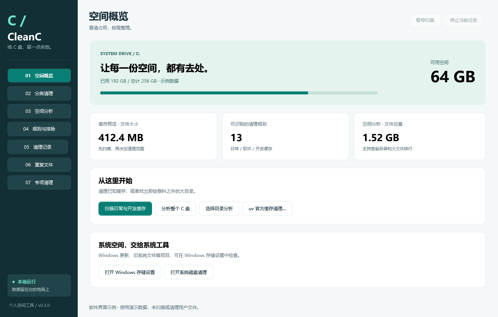
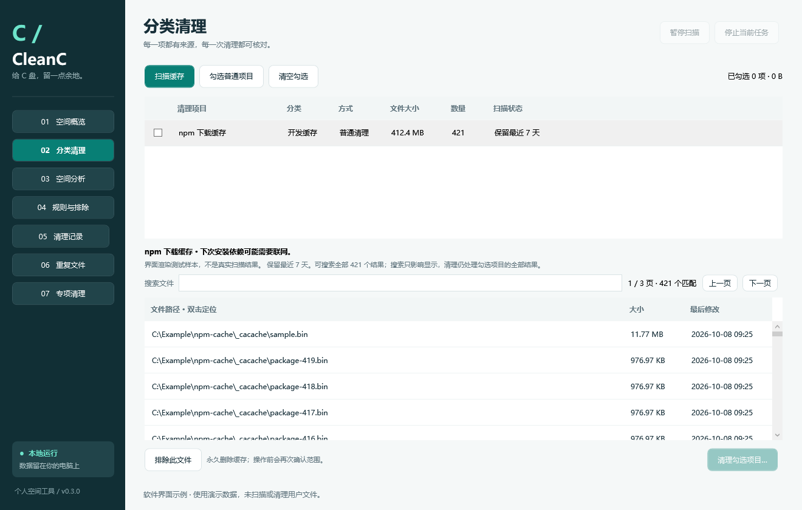
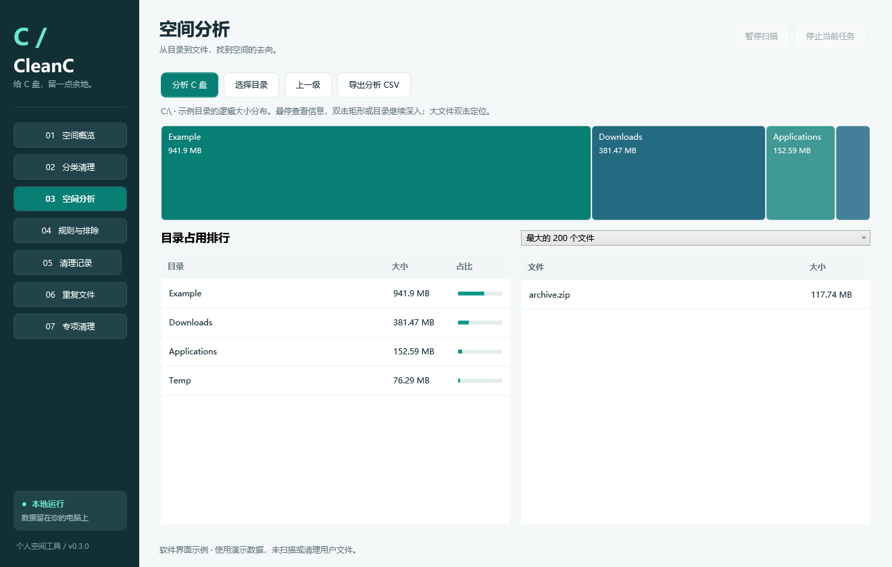
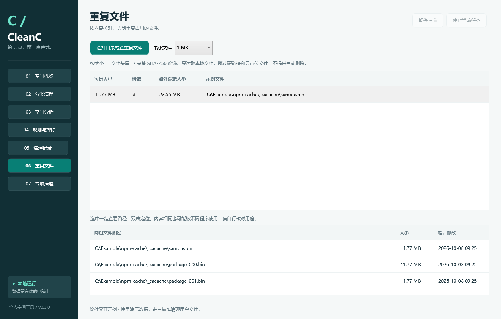
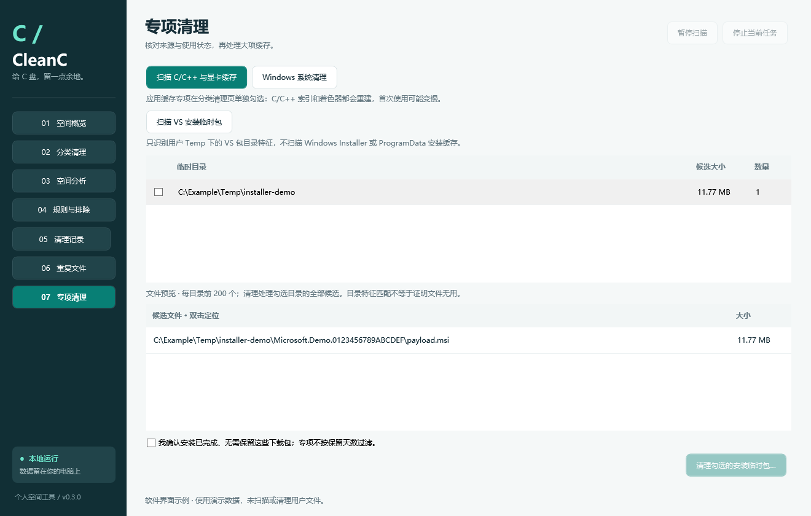

# lw.CleanC

当前版本：**0.3.0**。详细变化见 [CHANGELOG.md](CHANGELOG.md)。

[](https://github.com/lxw112190/lw.CleanC/actions/workflows/ci.yml)
[](LICENSE)

面向自己使用的 Windows C 盘空间分析与缓存清理工具。C# / .NET 10 / WPF，JSON 定义清理规则，无第三方 NuGet 依赖。

## 运行

在 [GitHub Releases](https://github.com/lxw112190/lw.CleanC/releases) 下载 Windows 10/11 x64 版本：

| 发布包 | 面向用户 | 运行环境 |
| --- | --- | --- |
| `lw.CleanC-v版本-win-x64-portable.zip`（推荐） | 希望解压即用的用户 | 自带 .NET/WPF 运行时，无需安装 .NET |
| `lw.CleanC-v版本-win-x64-framework-dependent.zip`（精简版） | 已安装 .NET 环境的用户 | 需要 [.NET 10 Desktop Runtime x64](https://dotnet.microsoft.com/en-us/download/dotnet/10.0) |

**运行软件不需要 .NET SDK。** SDK 用于编译开发；这里两种包的区别是是否自带运行时。本地构建的同类 ZIP 使用 `CleanC-` 前缀。

完整解压 ZIP 后运行 `CleanC.exe`。程序默认以普通用户运行；数据保存在可执行文件旁的 `Data` 目录，因此请解压到自己可写的目录，不要放到 Program Files。

两种版本都需要保持整个目录完整，不能只发送一个 exe。`Rules/default.rules.json` 在首次运行时复制为 `Data/rules.json`。之后更新程序不会自动覆盖个人规则。下载后可按 `SHA256SUMS.txt` 校验 ZIP 完整性。

## 软件截图

以下图片由实际 WPF 界面渲染，使用演示数据；文件路径、占用和重复分组仅用于介绍功能。

### 空间概览

查看 C 盘容量、缓存扫描结果，并进入分类清理或目录分析。



### 分类清理

查看清理影响、保留天数和文件明细，支持搜索全部结果、翻页与排除文件。



### 空间分析

矩形面积表示目录逻辑大小，支持目录下钻、大文件定位和文件类型统计。



### 重复文件

按文件内容分组，查看同组文件路径；重复检查仅展示和定位，不自动删除。



### 专项清理

C/C++ 预编译缓存和显卡着色器缓存需单独勾选。VS 安装临时包单独扫描，核对目录及文件清单、确认安装结束后再处理；存在安装进程或待重启状态时会阻止清理。



## 已实现

- 空间概览：C 盘已用、可用与总容量。
- 分类清理：扫描、逐项勾选、影响说明、文件预览、永久清理、停止任务。
- 空间分析：分析 C 盘或任意本地目录，目录占用矩形图、一级目录排行、最大的 200 个文件、按扩展名的类型统计、目录下钻、定位文件、CSV 导出。
- 重复文件：选择目录，按大小、文件头尾采样、完整 SHA-256 分阶段筛选相同内容；默认最小 1 MB，可改为 10 MB 或 100 MB。只展示和定位，文件可能在扫描后变化，处理前应自行核对用途。
- 扫描支持暂停/继续，暂停时也可以直接停止。
- 13 条扫描规则：用户临时文件、应用崩溃转储、DirectX 缓存、Chrome/Edge 配置缓存、VS Code 界面及扩展下载缓存、npm、pip、NuGet HTTP/插件、Yarn Classic、uv，以及 C/C++ ipch 和 NVIDIA 着色器专项。uv 规则只作统计，通过概览页的官方清理入口处理。
- VS 安装临时包专项：按目录特征识别用户 Temp 下的安装负载，独立预览和确认，不受普通缓存保留天数限制。匹配特征不等于证明文件无用，用户需要确认安装结束且无需保留下载包；会再次检查安装进程、待重启标记、排除项及文件身份。
- 个人设置：编辑 JSON 规则、保留天数、排除目录或单个预览文件。
- 清理记录：JSONL 逐文件写入直接清理的操作意图与结果，并汇总文件总量和可用空间变化。uv 官方操作记录命令、退出码、输出与可用空间变化，不提供逐文件清单。
- Windows 存储设置与系统磁盘清理入口，交由系统处理更新文件等项目。

## 使用流程

1. 运行“扫描日常与开发缓存”，每项默认不勾选。
2. 选中一行，查看清理影响及文件预览。按大小降序，每页 200 个文件，可搜索该项的全部结果；搜索仅影响显示，勾选清理仍处理该项扫描到的全部文件。单次扫描总上限为 100,000 个候选文件，达到上限会标明，可分批清理。
3. 关闭相关程序后重新扫描。浏览器、IDE 或开发进程运行时，相关规则会跳过。
4. 勾选要清理的分类，点击“清理勾选项目”，核对确认对话框。
5. 如要定位空间来源，使用“空间分析”。大文件只是分析结果，界面不提供直接删除大文件的操作。

“勾选普通项目”不会选中专项缓存。C/C++ 专项只允许 `Microsoft/vscode-cpptools/ipch` 内的 `.ipch` 文件，不清理同级数据库；NVIDIA 专项只扫描 `GLCache`、`DXCache`，首次运行图形软件可能重新编译着色器。先关闭相关软件再扫描。

安装包专项只扫描当前用户 `LocalAppData/Temp` 的直接子目录，通过 VS 包目录命名特征与扩展名白名单筛选。它不会验证每个包的数字签名，也不能判断安装在业务上是否已完成，因此必须自行核对并明确确认。用户 Temp 之外的 Windows Installer 和 ProgramData 安装缓存不在此范围。部分未识别负载会保留；当前不删除空目录。

升级时会备份规则文件，并按已见内置规则 ID 补充新项。已有 ID 的自定义修改保持原样；已记录的删除不会重新加入，路径与自定义规则重叠的新项会跳过。排除列表保持有效。

**清理会永久删除缓存，不进入回收站，也没有撤销功能。** 扫描只读取文件元数据。程序不会主动关闭软件、提权或强制解锁文件。

uv 由自身维护内部缓存索引，不参与普通逐文件清理。概览页“uv 官方缓存清理”会在确认后执行固定命令 `uv cache clean --cache-dir <默认缓存路径>`，清理整个缓存，**不受保留天数限制，也不局限于预览文件**。如缓存内存在排除项，操作会被阻止；不使用 `--force` 绕过锁。需要能在用户常见安装位置或 PATH 中找到 `uv.exe`。停止该任务仅终止本工具启动的 uv 子进程，记录为可能部分完成；不会关闭已有的 uv/Python 进程。此命令没有在本机真实缓存上执行验收，以保留用户数据。

## 范围和限制

- Chrome/Edge 内置规则覆盖 Default 和同级编号 Profile N 配置。编号配置自动发现，不跟随链接；每个浏览器最多发现 200 个编号配置。其他目录命名、其他浏览器及自定义包管理器缓存位置，需要明确规则；不会宣称覆盖所有软件。
- 默认不清聊天记录、Cookie、密码、下载文件、文档、项目产物、node_modules、虚拟环境、NuGet 全局 packages、Windows Installer、WinSxS、驱动仓库、系统还原点、休眠或分页文件。
- 缓存会重建，开发依赖可能重新下载。保留期是按最后写入时间判断，并不证明文件一定不再使用；请按说明选择项目。
- 文件大小为逻辑大小，不是承诺可释放的物理空间。空间分析可能重复统计硬链接，遇到不可访问的目录和链接会跳过。取消分析会保留并标注部分结果；取消缓存扫描不提供部分清理结果。
- 以普通用户读取全盘可能缺少受保护目录，扫描结果明确标注跳过项。采用流式目录枚举，尚未实现 MFT 加速或定时自动清理。文件类型按最后一个扩展名分组，最多单独聚合 2048 种扩展名，其余合并。
- 重复文件检查会读取文件内容，跳过云占位文件、多硬链接和不可访问文件，最多收集 100,000 个达到最小体积的候选文件。取消或达到上限都会标明结果不完整。额外逻辑大小按每组保留一份估算，不能视为可安全删除或实际可释放的大小。
- 清理记录包含本地文件路径，仅写入本机；发行包不包含个人规则、排除列表、历史或测试数据。
- 不依赖网络，不上传遥测。打开系统工具后的操作由用户自行完成。

## 自定义规则

在“规则与排除”中打开 `Data/rules.json`，编辑保存，点击“重新载入规则”，再重新扫描。格式示例：

```json
{
  "version": 1,
  "rules": [
    {
      "id": "my-app-cache",
      "name": "我的软件缓存",
      "category": "软件缓存",
      "description": "只包含可以重建的缓存。",
      "impact": "关闭软件后清理，下次启动会重建缓存。",
      "paths": ["%LOCALAPPDATA%\\Vendor\\Product\\Cache"],
      "processes": ["MyApp"],
      "minAgeDays": 14
    }
  ]
}
```

将新条目添加到现有 `rules` 数组即可。环境变量以运行用户的环境展开。进程名不带 `.exe`。不支持通配符和远程路径；保留天数为 1–3650；ID 和路径不能重复，规则根目录不能相互包含。

路径策略在代码中约束：内置明确缓存位置，及 LocalAppData 下至少三级且以 `Cache`、`Caches`、`Code Cache`、`GPUCache`、`CachedData`、`CachedExtensionVSIXs` 结尾的具体目录。Roaming 中只允许显式内置位置。新增其他类型目录需要先审查并修改路径策略，JSON 不能执行命令或放开系统目录。

## 清理时的核验

预览记录卷标识、文件 ID、大小、创建和修改时间。清理会重新检查规则、路径边界、排除项、保留期和相关进程。文件必须仍是预览中的同一个文件；变更、占用和多硬链接文件跳过。

目录遍历不跟随 reparse point。删除使用独占的 Windows 文件句柄，核验句柄实际路径，并通过同一文件句柄标记删除，避免普通“检查后按路径删除”的替换窗口。每次删除前先持久化意图日志；日志无法写入时停止。崩溃中断的记录会显示为未完成，需要查看逐文件记录，不会伪造完成汇总。

## 构建与验证

安装 .NET 10 SDK，在仓库根目录运行：

```powershell
dotnet build CleanC.sln -c Release
dotnet run --project tests/CleanC.Tests -c Release
dotnet run --project tests/CleanC.UiTests -c Release
powershell -ExecutionPolicy Bypass -File scripts/build.ps1
```

最后一个命令执行构建、核心测试、WPF 组件与渲染检查，再生成便携版 `dist/CleanC-portable-win-x64`、精简版 `dist/CleanC-framework-dependent-win-x64`，以及两个 ZIP 和 SHA256 校验文件。53 项核心测试仅操作 `artifacts/tests` 内的隔离文件，涵盖修改/替换文件、锁、排除项、暂停/取消、硬链接、目录联接、统计、矩形图与重复文件分阶段校验。渲染测试使用样本数据，输出七个页面在两种尺寸下的 PNG 到 `artifacts/ui`，并检查搜索、翻页、类型切换和导航状态。它不能替代完整的人工桌面交互验收。

## 参考资料

实现为独立编写，功能调研参考 [BleachBit](https://github.com/bleachbit/bleachbit)、[WinDirStat](https://github.com/windirstat/windirstat)、[Czkawka](https://github.com/qarmin/czkawka)。没有复制这些项目的源码或规则文件。

API 与默认缓存位置参考：

- [Microsoft：WPF 公共对话框](https://learn.microsoft.com/en-us/dotnet/desktop/wpf/windows/how-to-open-common-system-dialog-box)
- [Microsoft：GetFileInformationByHandle](https://learn.microsoft.com/en-us/windows/win32/api/fileapi/nf-fileapi-getfileinformationbyhandle)
- [Microsoft：SetFileInformationByHandle](https://learn.microsoft.com/en-us/windows/win32/api/fileapi/nf-fileapi-setfileinformationbyhandle)
- [npm：缓存](https://docs.npmjs.com/cli/v11/commands/npm-cache/)
- [pip：缓存](https://pip.pypa.io/en/stable/topics/caching/)
- [NuGet：管理全局包和缓存目录](https://learn.microsoft.com/en-us/nuget/consume-packages/managing-the-global-packages-and-cache-folders)
- [uv：缓存](https://docs.astral.sh/uv/concepts/cache/)

## 自动构建与发布

`main` 提交、Pull Request 和手动运行会在 Windows 上构建、测试并上传两种 ZIP；手动运行不会发布 Release。推送与项目版本一致的 `v*` 标签后，会在全部检查通过后自动发布 GitHub Release。

例如当前 `src/CleanC.App/CleanC.App.csproj` 中的版本为 `0.3.0`，提交代码后执行：

```powershell
git tag v0.3.0
git push origin v0.3.0
```

标签必须与项目版本完全一致。后续发布先修改项目版本及 CHANGELOG，再提交和推送对应标签。CI 使用仓库自带的 `GITHUB_TOKEN`，无需额外配置个人访问令牌；只有发布任务具有 `contents: write` 权限。标签重跑时可继续未完成的草稿，已发布的 Release 不覆盖。

每次构建会验证核心逻辑、WPF 布局，解压两个 ZIP 并检查实际运行时来源，生成 `SHA256SUMS.txt`。便携版应从包内加载 CLR/WPF，精简版应使用已安装的运行时；两个包都附带 MIT 许可证。自带运行时仍保留其自身许可证和第三方声明。

本地生成带版本号的同类附件：

```powershell
powershell -ExecutionPolicy Bypass -File scripts/build.ps1 -Versioned
```

更新 README 的界面截图：

```powershell
powershell -ExecutionPolicy Bypass -File scripts/update-screenshots.ps1
```

## 许可证

本项目采用 [MIT License](LICENSE)，版权归 lxw112190 所有。随便携包分发的 .NET/WPF 运行时及其他第三方组件遵循各自许可证，相关声明保留在发行目录中。
